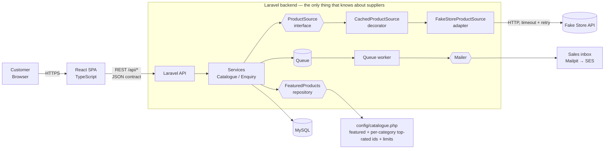
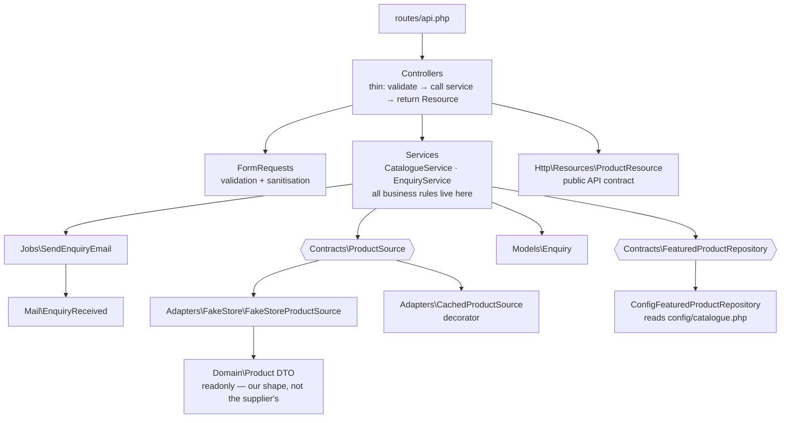
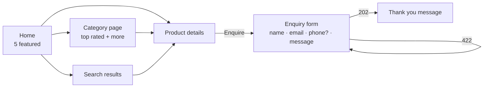
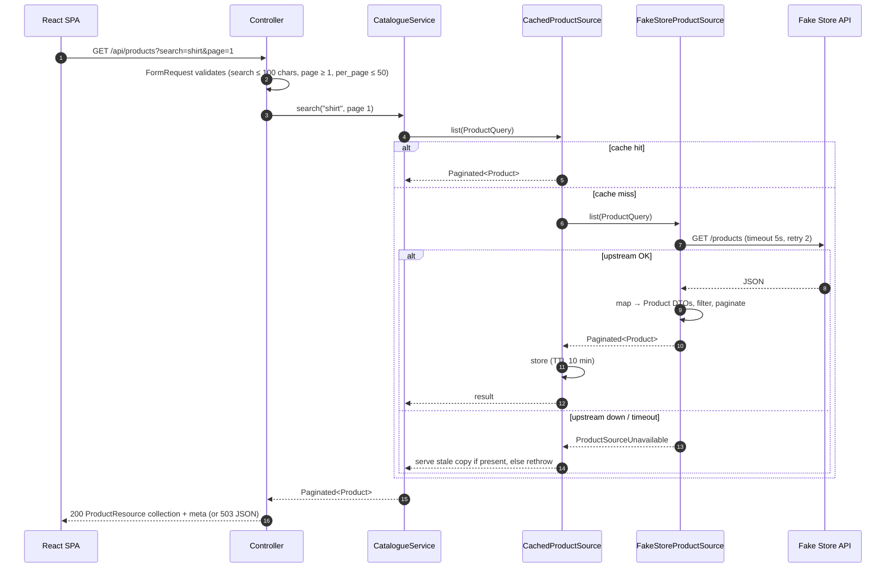
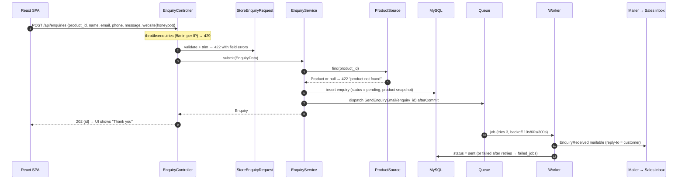
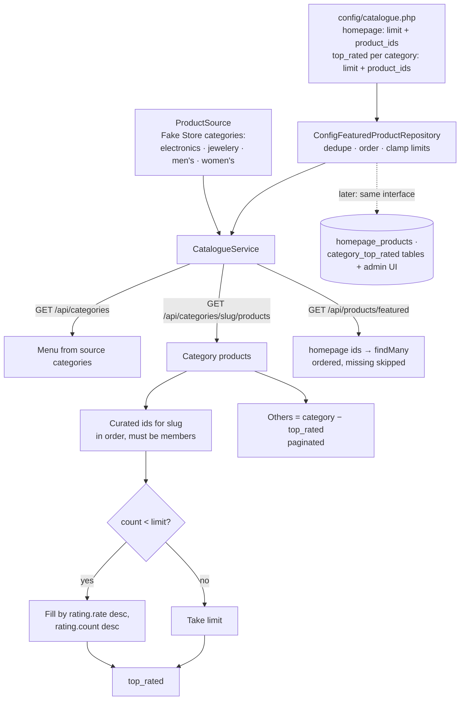
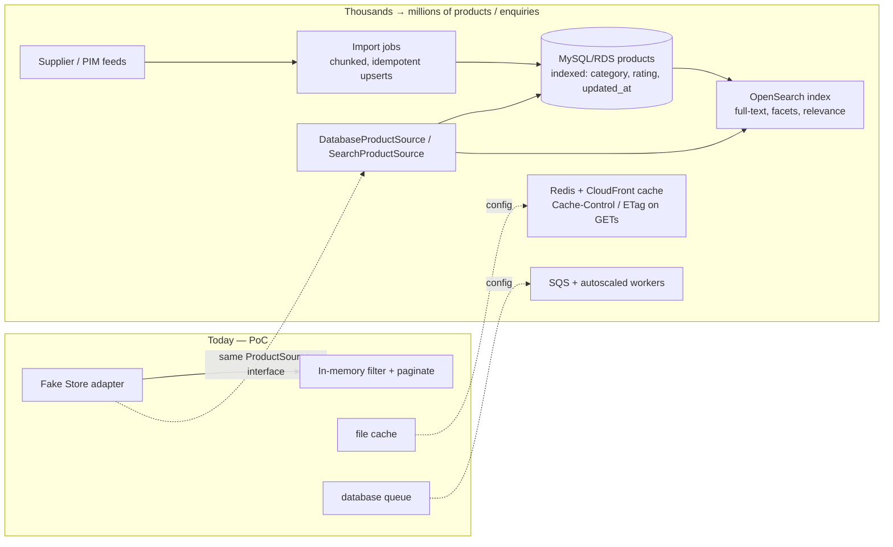
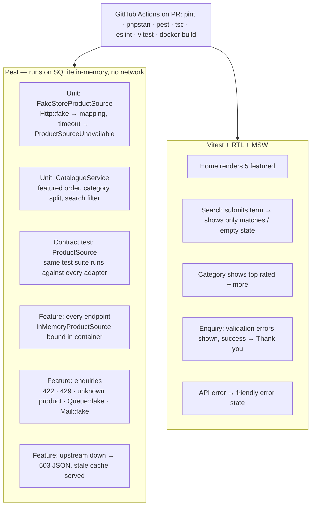
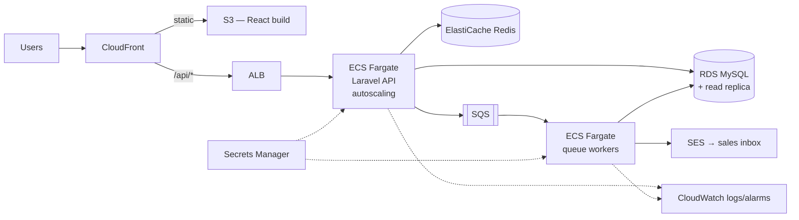
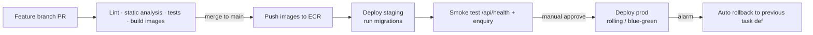

# Product Catalogue PoC — Architecture & Delivery Plan

> Goal: a small, working PoC that is a **foundation, not a throwaway**. Every external dependency
> (product data, look & feel, email, queue, cache) sits behind a seam so it can be swapped
> without rewriting the core. Built in a 2–3 hour time-box; scale is designed for, not built.

---

## 1. Stack decision

| Layer | Choice | Why |
|---|---|---|
| Client | **React 18 + TypeScript + Vite + Bootstrap 5** | Web is the fastest path for a reviewer (`docker compose up`, no simulator). Typed API contract. Neutral, license-safe theme (see §12). |
| Backend | **Laravel 13 (PHP 8.4), API-only** | Built-in validation, queues, mail, cache, rate limiting, HTTP client fakes. Every concern this PoC has is a first-party Laravel feature, so less custom code to own. |
| DB | MySQL 8 (local/RDS) · SQLite in-memory for tests | Stores enquiries. RDS-compatible. |
| Merchandising | `config/catalogue.php` (env-overridable) | Home featured products and, per category, the top-rated count + products are backend config (see §5.4). Categories come from the source. |
| Queue | `database` driver locally → **SQS** in AWS | Enquiry email never blocks the HTTP request. Driver is config, not code. |
| Mail | **Mailpit** locally (free, web inbox at :8025) → **SES** in AWS | Reviewer can *see* the sales email arrive. Provider is config, not code. |
| Cache | `file` locally → **Redis/ElastiCache** in AWS | Protects us from the upstream product API. |
| Tests | Pest (backend) · Vitest + React Testing Library + MSW (frontend) | Fast, expressive, and they run offline. |

---

## 2. Architecture (system context)



**Boundaries (what the assessors score on "Solution design"):**

1. **Client ↔ Backend**: a versioned JSON contract (`/api/...`) shaped by Laravel API Resources. The client never sees the Fake Store payload shape.
2. **Backend ↔ Product data**: the `ProductSource` interface. Fake Store is one adapter. A DB / PIM / OpenSearch adapter replaces it by changing a single binding.
3. **Backend ↔ Email**: Laravel Mailable + mail driver config. Changing provider is an `.env` change.
4. **Look & feel**: design tokens (CSS variables) + presentational components separate from data hooks, so the creative agency's work drops in without touching data logic.

---

## 3. Backend design (layers)



Rules (also written into `CLAUDE.md` so the AI follows them):

- Controllers contain **no business logic** — one service call each.
- Services depend on **interfaces**, never on Fake Store or `Http::` directly.
- Supplier JSON is mapped to `Domain\Product` **once**, inside the adapter.
- Every list endpoint is **paginated from day one** (contract won't break when data grows).
- Same service is reusable by a future admin UI / mobile app / CLI import — one source of business logic.

### Key code shapes

```php
// app/Contracts/ProductSource.php
interface ProductSource
{
    public function find(int $id): ?Product;
    /** @param int[] $ids @return Product[] (order preserved, missing ids skipped) */
    public function findMany(array $ids): array;
    /** @return Category[] */
    public function categories(): array;
    public function list(ProductQuery $query): Paginated;   // category?, search?, sort, page, perPage
}
```

```php
// app/Providers/AppServiceProvider.php — the ONE place the data source is chosen
$this->app->bind(ProductSource::class, fn ($app) => new CachedProductSource(
    inner: $app->make(FakeStoreProductSource::class),
    cache: $app->make('cache.store'),
    ttl:   config('catalogue.cache_ttl'),
));
```

```php
// app/Http/Controllers/CategoryProductsController.php
public function __invoke(string $category, ListProductsRequest $request, CatalogueService $catalogue)
{
    $result = $catalogue->category($category, $request->page(), $request->perPage());

    return response()->json([
        'top_rated' => ProductResource::collection($result->topRated),
        'products'  => ProductResource::collection($result->others)->response()->getData(true),
    ]);
}
```

---

## 4. API contract

| Method | Endpoint | Purpose / acceptance criterion |
|---|---|---|
| GET | `/api/products/featured` | Home — the curated "top rated" products (IDs + count from config, default 5) |
| GET | `/api/categories` | Category links |
| GET | `/api/categories/{slug}/products?page=&per_page=` | Category page — `top_rated` (per-category count + curated ids from config, filled by rating) + paginated `products` (the rest). Unknown slug → 404 |
| GET | `/api/products?search=&page=&per_page=` | Search — only products whose title/description/category match |
| GET | `/api/products/{id}` | Product details |
| POST | `/api/enquiries` | Enquiry → 202 Accepted, email queued |
| GET | `/api/health` | Liveness for Docker/ALB |

Errors use one JSON shape: `{ "message": "...", "errors": {...} }` — 422 validation, 404 not found,
429 throttled, **503 when the product supplier is down** (never leak a 500 + stack trace).

---

## 5. Flow diagrams

### 5.1 Customer journey (client)



### 5.2 Read path — browse / category / search (with cache)



### 5.3 Write path — enquiry (async email)



**Why persist then queue:** the customer's enquiry is never lost if the mail provider is down. The DB row is
the source of truth; the email is a notification that can be retried or replayed.

### 5.4 Top rated & featured — configured in the backend, per category

**Categories come from the product source.** These are Fake Store's four: `electronics`, `jewelery`,
`men's clothing` and `women's clothing`. There's no mapping layer. The backend exposes them as
URL-safe slugs (`electronics`, `jewelery`, `mens-clothing`, `womens-clothing`), and the adapter keeps
the slug ↔ supplier-name lookup. A new supplier category shows up in the menu automatically.

**What's configured:** for each category, the **number of units** in "Top rated" and **which products**.
The same goes for the home page. All of it lives in `config/catalogue.php` behind the
`FeaturedProductRepository` interface, so a DB table and admin screen can replace it later without
changing the services, controllers or client.

Why config rather than a DB table for the PoC: there is no admin UI yet, so a table would only be edited by
seeders or SQL anyway. Config is versioned in git, reviewed in a PR, testable with `config([...])`, and
limits can be overridden per environment through `.env`.

Fake Store product IDs by category, for reference: men's clothing `1–4`, jewelery `5–8`,
electronics `9–14`, women's clothing `15–20`.

```php
// config/catalogue.php
return [
    'source' => [
        'driver'    => env('CATALOGUE_SOURCE', 'fakestore'),
        'base_url'  => env('FAKESTORE_BASE_URL', 'https://fakestoreapi.com'),
        'timeout'   => (int) env('CATALOGUE_SOURCE_TIMEOUT', 5),
        'cache_ttl' => (int) env('CATALOGUE_CACHE_TTL', 600),
    ],

    // List 1 — Home page: "I have chosen 5 products to be top rated" (array order = display order)
    'homepage' => [
        'limit'       => (int) env('CATALOGUE_HOMEPAGE_LIMIT', 5),
        'product_ids' => [11, 3, 5, 18, 12],
    ],

    // List 2 — Category page "Top rated" section, keyed by category slug
    'top_rated' => [
        'default_limit' => (int) env('CATALOGUE_TOP_RATED_LIMIT', 3),
        'categories' => [
            'electronics'   => ['limit' => 3, 'product_ids' => [12, 11, 9]],  // fully curated
            'jewelery'      => ['limit' => 2, 'product_ids' => [5]],          // 1 curated + 1 by rating
            'mens-clothing' => ['limit' => 3, 'product_ids' => []],           // all by rating
            // 'womens-clothing' not listed → default_limit, all by rating
        ],
    ],

    'per_page'    => ['default' => 12, 'max' => 50],
    'sales_inbox' => env('SALES_INBOX_EMAIL', 'sales@example.test'),
];
```

| Setting | Meaning |
|---|---|
| `homepage.limit` / `homepage.product_ids` | Home page: **how many** and **which products**, in display order |
| `top_rated.categories.<slug>.limit` | **Number of units** in that category's "Top rated" section |
| `top_rated.categories.<slug>.product_ids` | **Which products**, in display order. If empty, or fewer than the limit, the rest is filled by highest `rating.rate`, with ties broken by `rating.count` |
| `top_rated.default_limit` | Used for any category not listed |

**Two independent lists, one per page.** This matches the two acceptance criteria. Each page reads exactly
one list, each list has its own order, and there are no cross-list rules. A product can be in both lists;
it's only an ID reference. Home page products are explicitly chosen and never filled by rating. If fewer
are configured than `limit`, the home page shows fewer.

### Interface

```php
// app/Contracts/FeaturedProductRepository.php
interface FeaturedProductRepository
{
    /** Home page — ordered, de-duplicated ids, capped at homepage.limit */
    public function homeProductIds(): array;

    /** Category page — curated ids for that category ([] = fill by rating) */
    public function categoryProductIds(string $categorySlug): array;
    public function categoryLimit(string $categorySlug): int;
}
```

`ConfigFeaturedProductRepository` is the only class that reads `config('catalogue.homepage')` or
`config('catalogue.top_rated')`. It removes duplicate IDs, casts them to int, and clamps limits to 1–20
(a bad value falls back to the default with a logged warning).

### How the category page is built

```php
// CatalogueService::category(string $slug, int $page, int $perPage): CategoryPage
$members = collect($this->products->byCategory($slug))->keyBy->id;   // unknown slug → CategoryNotFound (404)
$limit   = $this->featured->categoryLimit($slug);

// 1. curated first, in configured order, only if they belong to this category
$curated = collect($this->featured->categoryProductIds($slug))
    ->filter(fn ($id) => $members->has($id) ?: $this->logSkipped($slug, $id))
    ->take($limit)
    ->map(fn ($id) => $members[$id]);

// 2. fill up to the limit by rating
$fill = $members->except($curated->keys())
    ->sortByDesc(fn (Product $p) => [$p->ratingRate, $p->ratingCount])
    ->take($limit - $curated->count());

$topRated = $curated->concat($fill)->values();

// 3. "additional products" = everything else in the category, paginated
$others = $members->except($topRated->pluck('id'))->values();

return new CategoryPage($slug, $topRated->all(), Paginated::fromCollection($others, $page, $perPage));
```

Rules, each with a unit test:

- A curated ID that **isn't in that category** or **no longer exists** at the source is skipped and logged, never a 500.
- If there are fewer curated products than the limit, the rest is **filled by rating**. If the category has fewer products than the limit, it shows what exists.
- "Additional products" **never repeat** a product already shown in Top rated.
- An unknown category slug returns 404 JSON.
- Prod runs `php artisan config:cache`, so a config change needs a deploy or restart. That's acceptable for a PoC and is noted in DECISIONS.md. Next step: a DB repository and admin screen.



### At scale (millions of products)

The two lists move to two tables behind the same interface:
`homepage_products (product_id UNIQUE, position)` and
`category_top_rated (category_slug, product_id, position, UNIQUE(category_slug, product_id))`,
both cached in Redis (home list + one key per category) and
invalidated when an admin saves. Filling by rating becomes an indexed
`ORDER BY rating_rate DESC, rating_count DESC LIMIT n` on the products read model, or an OpenSearch sort.
"Others" uses keyset pagination.

## 6. Assumptions (→ DECISIONS.md)

1. **"I have chosen 5 products to be top rated"** = the owner *curates* them. The home page list (ids + count, default 5) is its own list in backend config (`config/catalogue.php`), independent of category top-rated lists. Not derived from the supplier's rating. Admin UI is a next step behind the same interface.
2. **Categories = the source's categories** (Fake Store: electronics, jewelery, men's clothing, women's clothing), exposed as URL-safe slugs. No separate business taxonomy in the PoC.
3. **Category "top rated"** = per category: `limit` (number of units) + curated `product_ids` in order; if fewer curated than the limit, filled by highest `rating.rate`. "Additional products" = the rest, paginated, never repeating the top-rated ones.
4. **Search** matches case-insensitive substring on title, description and category. Fake Store has no search endpoint, so the PoC adapter filters in memory over a cached catalogue (20 items). Results are empty-state friendly.
5. **Enquiry form fields**: name (required), email (required, RFC), phone (optional), message (optional, ≤ 2000). One product per enquiry.
6. **Sales inbox** = `SALES_INBOX_EMAIL` env var. Locally delivered to Mailpit.
7. **No auth / no customer accounts** in the MVP — public catalogue.
8. Prices shown as supplied, single currency, no stock/cart/checkout.
9. Fake Store product IDs are treated as opaque external IDs (`source_product_id`) so a future source can use strings/UUIDs.

## 7. Dropped / simplified (and why)

| Item | Decision | Why |
|---|---|---|
| Admin UI for featured products | Config array (+ env) | Not in acceptance criteria; a DB-backed repository + admin screen slots in behind `FeaturedProductRepository`. |
| Real search engine | In-memory filter behind interface | 20 products; OpenSearch/FULLTEXT is a new adapter, not a rewrite. |
| Final visual design | Neutral Bootstrap theme via tokens (open-source only) | Creative work in progress — tokens make the swap cheap. |
| IaC (Terraform/CDK) | Documented target, not built | Time-box; constraint only requires AWS compatibility. |
| E2E browser tests | Next day | Critical path is covered by API feature tests + component tests. |
| i18n, analytics, SEO/SSR | Out of scope | Not in criteria. |

---

## 8. Designed for millions (scale path — not built in the PoC)

The PoC is small on purpose. What matters is that **growth is a swap at a seam, not a rewrite**:



| Concern | At scale | Seam already in PoC |
|---|---|---|
| Product reads | Own read model in RDS (+ read replicas), synced from supplier by queued import jobs; never hit the supplier per request | `ProductSource` interface + cache decorator |
| Search | OpenSearch (or MySQL FULLTEXT as an intermediate step) | `ProductQuery` object with `search` field |
| Large lists | Keyset/cursor pagination (`WHERE id > ? LIMIT n`), never `OFFSET` on millions | Paginated contract on every list endpoint |
| Hot reads | CloudFront in front of `GET /api/*` + Redis app cache; SPA + images from S3/CloudFront | Stateless API, cache TTL in config |
| Enquiry volume | SQS + autoscaled workers; idempotency key on POST; `enquiries` indexed on `created_at`, `status`; archive/partition by month | Persist-then-queue design |
| API throughput | Stateless containers behind ALB, horizontal autoscaling | No session state, JSON API only |
| Resilience | Timeouts, retries, circuit breaker, stale-while-revalidate | 5s timeout + retry + stale fallback |
| Observability | Structured JSON logs, request IDs, CloudWatch metrics/alarms, failed-job alerts | Health endpoint, logged upstream failures |

---

## 9. Testing strategy



Each acceptance criterion maps to at least one feature test **and** one component test — listed in the PR description.

---

## 10. Repository structure

```
product-catalogue/
├── docker-compose.yml          # api, worker, web, mysql, mailpit — `docker compose up`
├── .env.example                # no secrets committed
├── README.md  DECISIONS.md  AI_USAGE.md  CLAUDE.md
├── .github/workflows/ci.yml
├── backend/                    # Laravel 13
│   ├── app/
│   │   ├── Contracts/          ProductSource.php, FeaturedProductRepository.php
│   │   ├── Domain/             Product.php, Category.php, ProductQuery.php, Paginated.php
│   │   ├── Adapters/           FakeStore/FakeStoreProductSource.php, CachedProductSource.php,
│   │   │                       ConfigFeaturedProductRepository.php
│   │   ├── Services/           CatalogueService.php, EnquiryService.php
│   │   ├── Http/Controllers/   Featured, Categories, CategoryProducts, Products, Enquiry
│   │   ├── Http/Requests/      ListProductsRequest.php, StoreEnquiryRequest.php
│   │   ├── Http/Resources/     ProductResource.php, CategoryResource.php
│   │   ├── Jobs/               SendEnquiryEmail.php
│   │   ├── Mail/               EnquiryReceived.php
│   │   ├── Models/             Enquiry.php
│   │   └── Exceptions/         ProductSourceUnavailable.php (→ 503 render)
│   ├── config/catalogue.php    # source, featured ids + limits, category top-rated, sales inbox
│   ├── database/migrations
│   └── tests/ Unit, Feature, Support/InMemoryProductSource.php
└── frontend/                   # React + TS + Vite
    └── src/
        ├── api/                client.ts, types.ts  (only place that knows the URL)
        ├── hooks/              useFeatured, useCategory, useSearch, useProduct
        ├── layout/             AppShell (top bar + sidebar), PageHeader
        ├── pages/              Home, Category, Search, Product
        ├── components/         ProductCard, ProductGrid, SearchBar, EnquiryOffcanvas,
        │                       RatingStars, EmptyState, ErrorState, LoadingSkeleton
        ├── theme/              tokens.scss (Bootstrap variable overrides), theme.ts (light/dark)
        └── __tests__/
```

---

## 11. Deployment

### Local (reviewer, < 10 minutes)

```bash
docker compose up --build      # no .env needed; runs migrations on start
# App:     http://localhost:8080
# API:     http://localhost:8080/api/health  (nginx proxies /api; API port not published)
# Inbox:   http://localhost:8025   (Mailpit — see the sales email)
```

### Target AWS (documented, not provisioned)



### CI/CD



---

## 12. Front-end design and email template

### Look & feel: neutral, license-safe placeholder theme

The creative agency owns the final brand, so the PoC ships a **neutral theme of its own**. Nothing is
taken from any company's product, logo, fonts or stylesheets.

- **Building blocks:** only open-source, MIT-licensed libraries, namely Bootstrap 5 (layout and components)
  and Bootstrap Icons. Their licences allow commercial use.
- **Fonts:** the visitor's system UI font stack, with no web-font download and nothing to license.
- **One swap point:** `frontend/src/theme/tokens.scss` (Bootstrap variable overrides: colours, radius,
  fonts, dark-mode background). Re-branding means editing this file, not components.
- **Light/dark mode:** Bootstrap's `data-bs-theme`, with the choice remembered per browser.

```scss
// frontend/src/theme/tokens.scss (excerpt)
$font-family-base: system-ui, -apple-system, 'Segoe UI', Roboto, 'Helvetica Neue', Arial, sans-serif;
$primary: #2c5be0;   $secondary: #5f6b7a;   $success: #1f9d55;   $danger: #d64545;
$body-bg: #f5f6f8;   $body-color: #1e2430;  $body-bg-dark: #121519;
@import 'bootstrap/scss/bootstrap';
```

### Screens

| Area | Pattern |
|---|---|
| Top bar | Brand, **search box + Search button**, light/dark toggle |
| Sidebar | **Category links** from `GET /api/categories`, active one highlighted; slides in on mobile |
| Page header | Breadcrumb `Catalogue / Category / Product` and page title |
| Product tiles | Bootstrap cards in a responsive grid; the whole tile is one accessible link |
| Enquiry | Form in a right-hand offcanvas panel on the product page; "Thank you" state in the panel |
| States | Skeleton loaders, empty states ("no matches"), error alerts with **Try again** |

### Component rules

- **Pages** fetch data via hooks; **components** are presentational (props in, JSX out).
- Only `src/api/client.ts` knows the backend URL. The client never calls Fake Store.
- Every data view has loading, empty and error states.
- Accessibility: labelled fields, focus moved into the enquiry panel, Escape closes it, `alt` text,
  visible focus ring, a skip link.

### Enquiry email: one Blade template plus a configurable subject

| What | Where | How to change |
|---|---|---|
| **Email content** (wording, layout, styling) | One Blade file: `backend/resources/views/mail/enquiry.blade.php` | Edit the file, or set `ENQUIRY_EMAIL_TEMPLATE` to another view |
| **Email subject** | `config/catalogue.php` → `enquiries.email.subject` | `ENQUIRY_EMAIL_SUBJECT="New enquiry: :product"` |

Subject placeholders: `:product`, `:product_id`, `:price`, `:name`, `:email`, `:enquiry_id`. The subject
is forced onto one line, since it's an email header. The template receives `$enquiry`, `$price` and
`$brand`. Customer input is printed with `{{ }}`, so it's always escaped. The template uses a table
layout with inline styles because many email clients ignore `<style>` blocks.

---

## 13. Security basics

- FormRequest validation on every input; `per_page` capped; search length capped.
- `throttle` on enquiries (5/min/IP) + honeypot field against bots.
- Product name/price in the email come from the **server-side lookup**, never trusted from the client.
- CORS restricted to `FRONTEND_URL`; API returns JSON errors only (`APP_DEBUG=false` outside local).
- Customer email used as `Reply-To`, never as `From` (prevents spoofing / SPF failures).
- No secrets in git; `.env.example` only; Secrets Manager in AWS.
- React escapes output by default; no `dangerouslySetInnerHTML` for supplier text.

---

## 14. Time-boxed execution plan (~3h)

| Step | Time | Output |
|---|---|---|
| 1. Plan + CLAUDE.md rules | 20m | This doc, agent rules, assumptions |
| 2. Backend skeleton: contracts, DTOs, Fake Store adapter + tests | 40m | Unit tests green |
| 3. Endpoints, Resources, Featured + Category + Search + Product | 30m | Feature tests green |
| 4. Enquiry: request, service, job, mailable, throttle | 25m | Feature tests green, email in Mailpit |
| 5. Frontend pages + api client + component tests | 45m | Vitest green |
| 6. Docker compose, README, DECISIONS, AI_USAGE, PR description | 20m | One-command run verified from a clean clone |
| 7. Self-review of AI output (diff read-through) | 15m | Fixes noted in AI_USAGE |

## 15. Next with another day

1. `DatabaseFeaturedProductRepository` + admin screen so the owner changes featured products and counts without a redeploy (same interface, config becomes the fallback).
2. `DatabaseProductSource` + queued import from supplier; MySQL FULLTEXT search.
3. Playwright E2E for the enquiry journey.
4. Terraform/CDK for the AWS target above.
5. Idempotency key on enquiry POST; observability (request IDs, structured logs, alarms).
